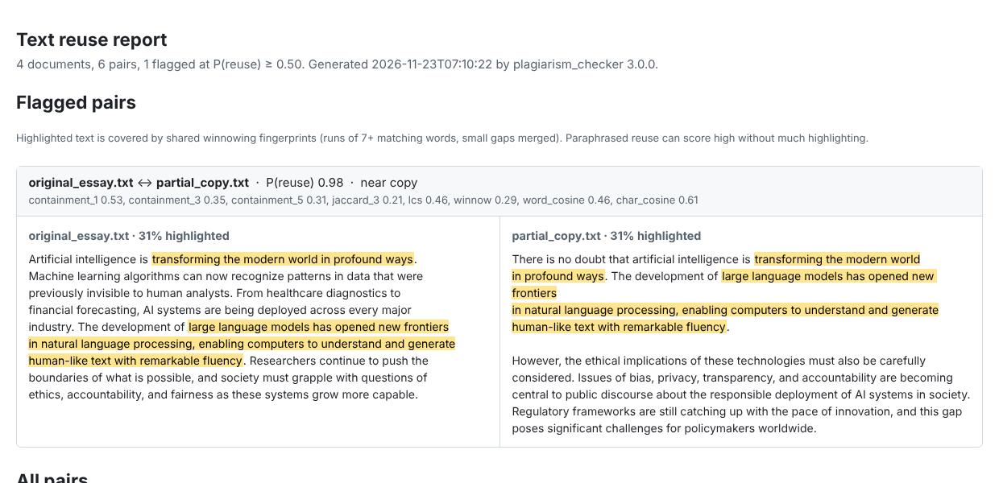
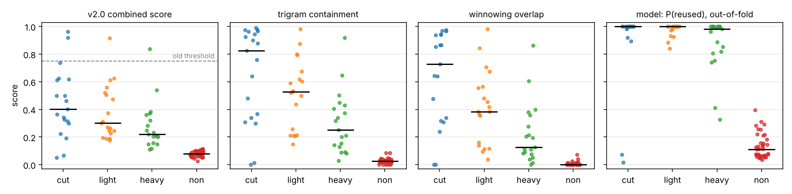

# Plagiarism Checker

[](https://github.com/Aranya2801/Plagiarism-checker-Python/actions/workflows/ci.yml)

A text reuse detector for comparing essays, assignments and reports. For every pair of documents it computes a set of lexical similarity measures (n-gram containment, longest common subsequence, winnowing fingerprints, TF cosine), turns them into a probability that one text was reused from the other, and says what kind of reuse it looks like: near copy, light revision, heavy revision or original. Copied passages are highlighted side by side in an HTML report.

For large collections, a MinHash/LSH index over short word windows picks out candidate pairs first, so not every pair has to be scored. On 10,000 documents that cuts 50 million comparisons down to about 35 thousand.

Everything is evaluated on the [Clough & Stevenson (2011)](https://doi.org/10.1007/s10579-009-9112-1) corpus of plagiarised short answers. Numbers are below and in [`experiments/results`](experiments/results/).



## Quick start

Python 3.9+. These commands work the same in PowerShell, cmd and bash.

```
git clone https://github.com/Aranya2801/Plagiarism-checker-Python.git
cd Plagiarism-checker-Python
pip install -e .
plagcheck samples
```

Output:

```
plagcheck 4 documents, 6 pairs scored, 0.01s
1 pair(s) flagged at P(reuse) >= 0.50

  0.98  original_essay.txt  <->  partial_copy.txt
        near copy       3-gram containment 0.35  winnowing 0.29  LCS 0.46
  0.20  original_essay.txt  <->  paraphrased_essay.txt
        original        3-gram containment 0.06  winnowing 0.03  LCS 0.35
  ...
```

(The second line is a miss: `paraphrased_essay.txt` really is a rewrite of the original. More on that under [Limitations](#limitations).)

Other ways to run it:

```
plagcheck essay1.txt essay2.txt essay3.txt          # just these files
plagcheck submission.txt --against reference/       # one file vs. a folder
plagcheck essays --html report.html --json scores.json
plagcheck essays -t 0.7 --top 0                     # stricter threshold, list every pair
plagcheck big_folder -r --lsh on                    # recursive, force the LSH pre-filter
```

`--fail-on-match` makes it exit with status 2 when something is flagged, which is useful in scripts. PDF and Word files work if you install the extras: `pip install -e ".[pdf,docx]"`.

From Python:

```python
from plagiarism_checker import PlagiarismChecker

pc = PlagiarismChecker(threshold=0.5)
pc.add_directory("essays")
result = pc.check_all()

for m in result.flagged():
    print(f"{m.doc1} / {m.doc2}: {m.score:.2f} ({m.pretty_label})")
    print("   copied spans in doc1:", m.spans1[:3])   # character offsets

# one submission against everything loaded
res = pc.check_file_against("new_submission.txt")
```

## How it works

**1. Tokenisation.** Unicode-aware word tokens that keep their character offsets into the original text. That's what makes highlighting possible. Stopwords are kept for n-gram measures (dropping them destroys exactly the word sequences that copying preserves) and dropped for the cosine and LSH steps.

**2. Pairwise features.** All of these are in [0, 1] and depend only on the two documents involved:

| feature | what it is |
|---|---|
| `containment_n` (n = 1, 3, 5) | Broder's containment of word n-grams, \|A∩B\| / \|A\|, taking the max over both directions. Unlike Jaccard, it doesn't penalise a short text copied into a long one. |
| `jaccard_3` | Jaccard similarity of word trigrams |
| `lcs` | word-level longest common subsequence divided by the shorter length; it survives insertions and deletions |
| `winnow` | share of winnowing fingerprints in common (Schleimer et al. 2003, the MOSS algorithm), on word 4-grams with window 4, so any shared run of 7+ words is guaranteed to be caught |
| `word_cosine` | cosine of sublinear TF vectors over content words and bigrams |
| `char_cosine` | cosine over character 3–5 grams, which tolerates inflection and small edits |

I deliberately left corpus-dependent measures (TF-IDF, LSA) out of the model. IDF computed from two documents is meaningless, and I wanted `plagcheck a.txt b.txt` to give the same score for a pair as a run over 1,000 files. The benchmark shows they don't add anything here anyway (section 3 of the results).

**3. Scoring.** A multinomial logistic regression on the 8 features predicts cut / light / heavy / non. The reuse score is `1 - P(non)`. The weights live in `plagiarism_checker/data/model.json` and inference is plain numpy, so scikit-learn is only needed for the experiments.

**4. Highlighting.** Shared winnowing fingerprints are mapped back to token positions, then to character spans. Nearby spans are merged so that one changed word doesn't split a copied sentence in two.

**5. Candidate generation (large collections).** Every document is cut into overlapping 25-word windows (stride 8). Each window gets a 128-permutation MinHash signature, banded 32×4 for LSH. Two documents become a candidate pair if any of their windows collide. Windowing matters: plain whole-document MinHash estimates Jaccard, which stays low when a short answer is lifted from a long source, so whole-document LSH misses partial copying. The checker switches this on automatically from 200 documents.

## Results

Corpus: 95 short answers (200–300 words) to 5 computer science questions, each written by copy-paste (`cut`), light revision, heavy revision, or from the participant's own knowledge (`non`). Each answer is compared with the Wikipedia source text for its question. All learned numbers use **leave-one-task-out** cross-validation: train on four topics, test on the fifth. Random splits would leak vocabulary between train and test.

**Flagging reused text (any of cut/light/heavy vs. non):**

| method | accuracy | F1 |
|---|---|---|
| previous version (v2.0) with its default threshold 0.75 | 0.442 | 0.131 |
| previous version, threshold tuned in CV | 0.937 | 0.946 |
| trigram containment alone, threshold tuned in CV | 0.937 | 0.946 |
| winnowing alone, threshold tuned in CV | 0.926 | 0.936 |
| **current model (8 features, logistic regression)** | **0.958** | **0.964** |

The first row is why I rewrote this. The old combined score actually ranked pairs well (AUC 0.971), but its fixed 0.75 threshold sat above almost every real case. It flagged 4 of the 57 reused answers.

**Type of reuse (4 classes):** accuracy 0.779, macro-F1 0.723. Confusion matrix:

| true \ predicted | cut | light | heavy | non |
|---|---|---|---|---|
| cut | 16 | 1 | 0 | 2 |
| light | 3 | 9 | 7 | 0 |
| heavy | 2 | 4 | 11 | 2 |
| non | 0 | 0 | 0 | 38 |

Original answers are never confused with reused ones. The hard part is telling light from heavy revision, which Clough & Stevenson also report: the boundary depends on the writer, and the annotations reflect what participants were *asked* to do, not what they actually did.



**Same topic, no copying.** Two people answering the same question share a lot of vocabulary. Across all 129 pairs of independently written answers to the same question, the mean reuse score is 0.13 and 5 pairs (3.9%) cross 0.5.

**LSH pre-filter.** On the corpus, the default index keeps 8% of document pairs and every light and heavy revision. It keeps 17 of 19 cut-and-paste answers; the other two are explained under Limitations. Whole-document MinHash at a similar pruning rate drops to 0.53 recall on heavy revisions. On synthetic collections with planted copies ([`experiments/scaling.py`](experiments/scaling.py)):

| documents | all pairs | after LSH | recall verbatim / edited | LSH time | brute force (est.) |
|---|---|---|---|---|---|
| 500 | 124,750 | 88 | 1.00 / 0.90 | 0.8 s | 17 min |
| 2,000 | 1,999,000 | 1,495 | 1.00 / 0.82 | 3.2 s | 4.5 h |
| 10,000 | 49,995,000 | 34,881 | 1.00 / 0.95 | 18 s | 113 h |

(Timings from one run of the script and will vary by machine. "Edited" means every 4th word of the 60-word pasted passage was replaced.)

Full tables, the ablation study and per-pair features are in [`experiments/results`](experiments/results/). To reproduce them, see [`experiments/README.md`](experiments/README.md).

## Limitations

- **Heavy paraphrase is the weak spot**, as it is for any lexical method. `samples/paraphrased_essay.txt` rewrites nearly every phrase with synonyms and scores only 0.20. The corpus's "heavy" answers still score high because people revising under time pressure keep a lot of the source's wording. A deliberate paraphraser wouldn't. `features.SemanticEncoder` wraps sentence-transformers for embedding similarity, but it isn't in the shipped model yet because I haven't evaluated it properly.
- **The model was trained on 95 pairs**, from one genre (short CS answers), one language, and one source per answer. The probabilities are calibrated for that setting. For long essays or other subjects, treat the score as a ranking and look at the highlighted passages.
- **Two of the "cut" answers can't be detected from the corpus files.** `g2pE_taskc` and `g4pD_taskb` were copied from parts of the Wikipedia articles that aren't in the source excerpts. They count as misses in every number above.
- It only finds reuse *between the documents you give it*. There's no web search.
- A high score means "a person should look at this pair", not "this is plagiarism". Quoting with citation, shared templates and common phrasing all produce overlap.

## Project layout

```
plagiarism_checker/
    text.py          tokenizer with offsets, stopwords, light stemmer
    features.py      pairwise measures, Document, CorpusIndex (TF-IDF/LSA), SemanticEncoder
    fingerprint.py   winnowing, span matching, MinHash, LSH, windowed candidate index
    model.py         logistic-regression scorer (numpy only)
    checker.py       PlagiarismChecker API
    report.py        HTML report
    cli.py           plagcheck command
    io.py            .txt/.md/.pdf/.docx reading with encoding fallbacks
    data/model.json  trained weights
experiments/
    corpus.py        loader for the Clough & Stevenson corpus
    benchmark.py     all evaluation in "Results", retrains model.json
    scaling.py       LSH on synthetic collections
    results/         generated tables and plot
tests/               pytest, runs on Linux and Windows in CI
samples/             four small example texts
```

## Changes from v2

v2 was a single script uploaded as loose files, so the package imports (and the CI workflow) never worked. Beyond fixing that, the main things I changed:

- The old `-q FILE -d DIR` mode couldn't run, because both options were in one mutually exclusive argparse group.
- `--stemming` was accepted but never used.
- TF-IDF was refit on each pair of documents, which makes IDF meaningless. Replaced with corpus-independent features plus an optional corpus index.
- MinHash used Python's `hash()` (randomised on every run) and overflowed int64. On Windows it crashed, because numpy's default int there is 32-bit. While fixing it I introduced a subtler bug of my own: the hash family was almost monotone, so Jaccard came out roughly double. There's a test for that now.
- Two empty documents used to score 1.0 ("identical").
- The HTML report didn't escape file names or text.
- Terminal output used emoji and box-drawing characters, which crash on some Windows consoles (cp1252). It's plain ASCII now, with colour only when writing to a terminal.
- The "matching phrases" were built from text with stopwords removed, so they never appeared in the documents. Replaced by fingerprint spans on the original text.

## References

- A. Broder. *On the resemblance and containment of documents.* Compression and Complexity of Sequences, 1997.
- S. Schleimer, D. Wilkerson, A. Aiken. *Winnowing: local algorithms for document fingerprinting.* SIGMOD 2003.
- P. Clough, M. Stevenson. *Developing a corpus of plagiarised short answers.* Language Resources and Evaluation 45(1), 2011.
- M. Potthast, B. Stein, A. Barrón-Cedeño, P. Rosso. *An evaluation framework for plagiarism detection.* COLING 2010.
- J. Leskovec, A. Rajaraman, J. Ullman. *Mining of Massive Datasets*, ch. 3 (MinHash and LSH).

## License

MIT
